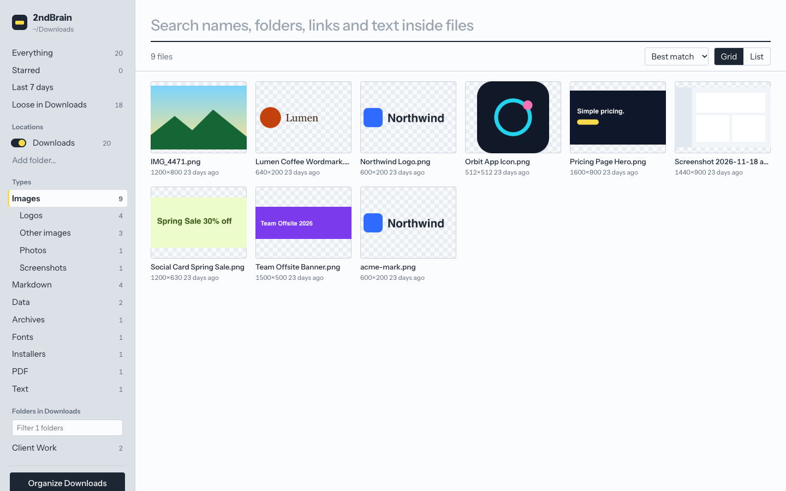

# 2nd Brain

Find anything you ever downloaded, in seconds. Works on Mac and Windows.

2nd Brain indexes your `~/Downloads` folder (and any other folders you add), sorts what's in it, and lets you search names, folders, download links and the text inside your files at the same time. It can tidy Downloads into folders, name the files called `IMG_4471.png` or `Untitled 147.md`, and it plugs into Claude Code and Codex, so you can just ask your agent: *"find the logo I downloaded last week."*

Everything runs on your computer. Nothing is uploaded. Free and open source under the MIT license.



## What it does

- **Indexes all of Downloads**, including subfolders: name, type, size, dates, image size, the web address a file was downloaded from, and the text inside `.md`, `.txt`, `.pdf`, `.docx`, code and data files.
- **Sorts images** into logos, screenshots, photos and other images.
- **Searches** names, folders, download links, tags and file text at the same time.
- **Organize Downloads** makes a plan for the loose files in Downloads. You untick anything you want to keep in place, then click Move. Every run can be undone.
- **Names unnamed files.** Claude Code looks at files with junk names (`IMG_1234`, `Screenshot 2026-…`, `Untitled 147`, `ChatGPT Image …`, long IDs) and suggests real names. You edit or untick them, then rename. Every rename can be undone.
- **More folders.** Add Desktop, Dropbox or a project folder with **Add folder…**. Each location has an on/off switch for search. Organize only ever changes Downloads.
- **Star and select.** Hover a file to star it. Drag a box (or ⌘-click, Shift-click, ⌘A) to select many files, then Star, Unstar or Move to Trash.
- **Right-click a folder** in the left column: Optimize names, Show in Finder (File Explorer on Windows), or Delete all contents (strong warning, you type the folder name, everything goes to the Trash or Recycle Bin).
- **Watches** your folders and updates the index a few seconds after files change. The status at the bottom left shows progress and time left.
- **Works with your AI agent** through an MCP server: search, tag, organize, rename and undo from Claude Code or Codex.

### Safety

- Nothing is ever deleted permanently. Files go to the macOS Trash, so Finder's **Put Back** works. On Windows they go to the Recycle Bin, so **Restore** works. 2nd Brain will not delete files on USB drives or network folders, because those have no Recycle Bin.
- Organize never overwrites a file. If a name is taken, the file gets ` (2)`. It leaves alone files in subfolders, partial downloads, and anything changed in the last 24 hours.
- Renaming skips files inside code projects and websites, so nothing breaks.
- Files with secret-looking names (`.env`, `*.pem`, `api-keys.md` and similar) are indexed by name only. Their text is never read or sent to an AI.
- Online-only cloud files (Dropbox, iCloud "Optimize storage", OneDrive "Files On-Demand") are indexed by name, type and size only, so your cloud provider does not download them.
- AI naming sends only small previews and the first part of a document's text to Claude, through your own Claude Code login. Nothing else leaves your computer.

## Requirements

**Mac**

- macOS 13 Ventura or later (Apple silicon or Intel)
- [Node.js](https://nodejs.org) 22.13 or later: `brew install node`
- Optional: [Claude Code](https://claude.com/claude-code) for AI file naming and agent tools
- Optional: `brew install poppler` to search the text inside PDFs
- Optional, for the Dock app: Xcode Command Line Tools (`xcode-select --install`) and `brew install librsvg`

**Windows**

- Windows 10 or 11
- [Node.js](https://nodejs.org) 22.13 or later: `winget install OpenJS.NodeJS.LTS`
- Git: `winget install Git.Git`. No Git? [Download the ZIP](https://github.com/MonarchLabsLLC/2nd-Brain/archive/refs/heads/main.zip), unzip it to `%USERPROFILE%\2nd-Brain`, and skip the `git clone` line below.
- Optional: [Claude Code](https://claude.com/claude-code) for AI file naming and agent tools
- Optional: `winget install oschwartz10612.Poppler` to search the text inside PDFs
- The Start menu app uses Microsoft Edge, which comes with Windows

## Install

### Mac

```bash
git clone https://github.com/MonarchLabsLLC/2nd-Brain.git ~/2nd-Brain
cd ~/2nd-Brain
scripts/install.sh
```

Then open <http://localhost:4321>, or open `~/Applications/2ndBrain.app` and drag it to your Dock.

The installer:

1. checks for Node.js 22.13 or later,
2. installs the dependencies,
3. indexes your Downloads folder,
4. starts 2nd Brain at login (a background service on `localhost:4321`),
5. connects the MCP server to Claude Code and Codex, if you have them,
6. builds the Dock app, if your Mac has the tools for it (`--no-app` skips this).

You can run it again at any time. It updates what is already installed.

### Windows

In PowerShell:

```powershell
git clone https://github.com/MonarchLabsLLC/2nd-Brain.git $HOME\2nd-Brain
cd $HOME\2nd-Brain
powershell -ExecutionPolicy Bypass -File scripts\install.ps1
```

Then open <http://localhost:4321>, or open **2nd Brain** from the Start menu and pin it to the taskbar.

The installer does the same steps as on a Mac. It needs no administrator rights:

1. checks for Node.js 22.13 or later,
2. installs the dependencies,
3. indexes your Downloads folder (wherever Windows keeps it, including OneDrive),
4. starts 2nd Brain at login (a scheduled task named `2ndBrain` that runs `localhost:4321` in a hidden window),
5. connects the MCP server to Claude Code and Codex, if you have them,
6. adds **2nd Brain** to the Start menu (`-NoApp` skips this). It opens in its own Edge window.

### Install with your AI agent

Paste this into Claude Code, Codex or another coding agent:

```text
Install 2nd Brain for me from https://github.com/MonarchLabsLLC/2nd-Brain
Clone it to ~/2nd-Brain, read the README, and run the installer for my system
(scripts/install.sh on a Mac, scripts\install.ps1 on Windows).
If Node.js 22.13+ is missing, tell me the command to install it and wait.
When it finishes, confirm http://localhost:4321 responds and that the
2ndbrain MCP server is registered, then tell me to open a new session.
```

### Update

```bash
cd ~/2nd-Brain
git pull
scripts/install.sh                                            # Mac
powershell -ExecutionPolicy Bypass -File scripts\install.ps1  # Windows
```

### Uninstall

```bash
cd ~/2nd-Brain
scripts/uninstall.sh          # keeps your index and settings
scripts/uninstall.sh --data   # also deletes the index, thumbnails and settings
```

On Windows:

```powershell
powershell -ExecutionPolicy Bypass -File scripts\uninstall.ps1        # keeps your index and settings
powershell -ExecutionPolicy Bypass -File scripts\uninstall.ps1 -Data  # also deletes the index, thumbnails and settings
```

Your own files are never touched. Delete the `~/2nd-Brain` folder afterwards.

## Use it

Open <http://localhost:4321> (or the Dock app).

- Type to search. `/` jumps to the search box, `Esc` closes the details panel.
- Filter by type, tag, star or folder on the left.
- Click **Organize Downloads** to see a plan before anything moves.
- Click **Name unnamed files** to let Claude suggest names.

### From Claude Code or Codex

The installer registers the MCP server as `2ndbrain`. Open a new session and ask, for example:

- "Find the logo I downloaded last week"
- "Show me the markdown files about the launch from this month"
- "Star that file and tag it brand"
- "Organize my downloads" (your agent shows the plan first and moves files only after you say yes)
- "Undo the last organize"
- "Name the unnamed images in my Downloads"
- "Turn off Dropbox in 2nd Brain search"

Tools: `search_downloads`, `get_download_details`, `downloads_overview`, `tag_download`, `plan_organize`, `apply_organize`, `undo_organize`, `manage_locations`, `find_unnamed_files`, `rename_files`, `reindex_downloads`.

The MCP server reads the index directly, so it works even when the web app is not running.

To add it by hand (run from the 2nd Brain folder):

```bash
# Claude Code
claude mcp add --scope user 2ndbrain -- "$(command -v node)" --disable-warning=ExperimentalWarning "$(pwd)/src/mcp.mjs"
# Codex
codex mcp add 2ndbrain -- "$(command -v node)" --disable-warning=ExperimentalWarning "$(pwd)/src/mcp.mjs"
```

On Windows (PowerShell):

```powershell
claude mcp add --scope user 2ndbrain '--' (Get-Command node).Source --disable-warning=ExperimentalWarning "$PWD\src\mcp.mjs"
```

For Cursor or another MCP client, use the same command: `node --disable-warning=ExperimentalWarning /path/to/2nd-Brain/src/mcp.mjs` over stdio.

## Organize folders

| Type | Folder in Downloads |
| --- | --- |
| Logos | `Images/Logos` |
| Screenshots | `Images/Screenshots` |
| Photos | `Images/Photos` |
| Other images | `Images/Other` |
| Markdown | `Docs/Markdown` |
| Text | `Docs/Text` |
| PDF | `Docs/PDF` |
| Word, PowerPoint, Excel | `Docs/Office` |
| JSON, CSV, YAML | `Data` |
| HTML and code | `Code` |
| Video, audio | `Media/Video`, `Media/Audio` |
| Zip and other archives | `Archives` |
| DMG, PKG | `Installers` |
| Fonts | `Fonts` |

To use your own folder names, create `settings.json` in the data folder (`~/Library/Application Support/2ndBrain` on a Mac, `%LOCALAPPDATA%\2ndBrain` on Windows):

```json
{
  "folders": {
    "logo": "Images/Brand",
    "graphic": "Images/Misc"
  }
}
```

Keys: `logo`, `screenshot`, `photo`, `graphic`, `markdown`, `text`, `pdf`, `office`, `data`, `code`, `video`, `audio`, `archive`, `installer`, `font`. Folders always stay inside Downloads.

## Settings

| Environment variable | What it does | Default |
| --- | --- | --- |
| `SECONDBRAIN_DOWNLOADS` | Main folder to index and organize | your Downloads folder |
| `SECONDBRAIN_DATA` | Where the index, thumbnails and settings live | see below |
| `SECONDBRAIN_PORT` | Web app port | `4321` |
| `SECONDBRAIN_NAMING_MODEL` | Claude model for AI naming | `sonnet` |
| `SECONDBRAIN_CLAUDE` | Path to the `claude` CLI | found automatically |

## Where things live

| What | Mac | Windows |
| --- | --- | --- |
| Index database | `~/Library/Application Support/2ndBrain/index.sqlite` | `%LOCALAPPDATA%\2ndBrain\index.sqlite` |
| Thumbnails | `~/Library/Application Support/2ndBrain/thumbs/` | `%LOCALAPPDATA%\2ndBrain\thumbs\` |
| Settings | `~/Library/Application Support/2ndBrain/settings.json` | `%LOCALAPPDATA%\2ndBrain\settings.json` |
| Background service log | `~/Library/Logs/2ndBrain.log` | `%LOCALAPPDATA%\2ndBrain\2ndBrain.log` |

## Run it without installing

```bash
npm install
npm start                           # http://localhost:4321, stops when you close Terminal
npm run index                       # rescan now
node src/cli.mjs search logo        # quick search from the terminal
node src/cli.mjs plan               # show an organize plan (moves nothing)
npm test                            # tests use a temporary folder, never your Downloads
```

## How it works

Plain Node.js with no build step: `node:sqlite` with full-text search for the index, a small `node:http` server and vanilla JavaScript for the web app, and the official MCP SDK for agent tools.

Everything that differs between systems sits in `src/platform/`:

- **Mac** (`darwin.mjs`): built-in macOS tools (`sips`, `mdls`, `qlmanage`, `textutil`, `trash`) for image sizes, download links, previews and document text. The Dock app is a small Swift window around the local web app.
- **Windows** (`win32.mjs`): image sizes and document text (`.docx`, `.odt`, `.rtf`, `.html`) are read in JavaScript, download links come from the `Zone.Identifier` mark browsers add to downloads, and one long-running PowerShell helper (`win-helper.ps1`) makes the same previews File Explorer shows, reads cloud-file attributes and sends files to the Recycle Bin.

## License

[MIT](LICENSE) © 2026 Monarch Labs LLC. Use it, change it, share it, sell it. No warranty.
